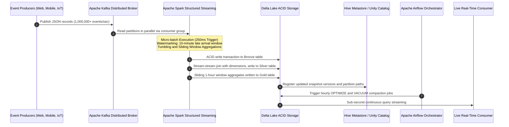
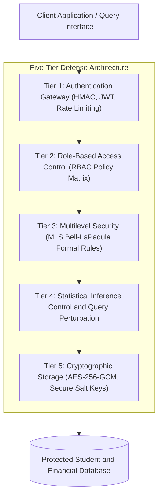
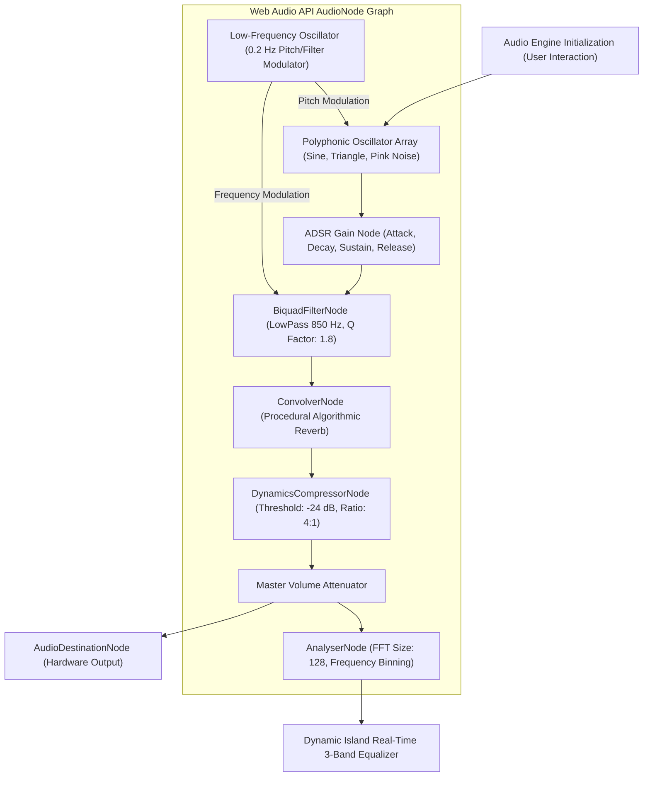
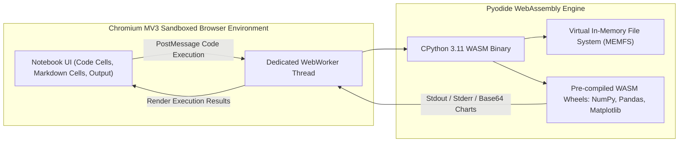

# System Architecture and Engineering Whitepaper

## Ahmed Abo Bakr Portfolio Ecosystem

This document provides technical specifications, dimensional schemas, streaming semantics, and architectural diagrams for the production systems showcased in the portfolio.

---

## 1. Enterprise Lakehouse Architecture: Medallion Paradigm

The Web-to-Warehouse and Big Data pipelines utilize the Medallion Architecture pattern to ensure data lineage, auditability, and query performance.

```mermaid
flowchart TD
    subgraph Layer_Raw ["Ingestion Layer: 35 Sources"]
        R1["E-Commerce REST Endpoints"]
        R2["Market Price Web Feeds"]
        R3["Kafka Real-Time Streams"]
        R4["Batch File Drops (JSON / CSV / Parquet)"]
    end

    subgraph Layer_Bronze ["Bronze Layer: Raw Append-Only"]
        B1["Bronze Delta Storage: S3 / ADLS"]
        B2["Schema Validation on Write"]
        B3["Audit Metadata: Ingestion Timestamp, Source UUID, Checksum"]
    end

    subgraph Layer_Silver ["Silver Layer: Cleaned and Conformed"]
        S1["Type Casting and Null Coalescing"]
        S2["Fuzzy Record Deduplication (Levenshtein Distance)"]
        S3["12 Data Quality Circuit Breakers"]
        S4["Change Data Capture (CDC Type 2 SCD)"]
    end

    subgraph Layer_Gold ["Gold Layer: 29-Table Kimball Star Schema"]
        G1["Fact Tables: FACT_PRICE_HISTORY, FACT_TRANSACTIONS"]
        G2["Dimension Tables: DIM_PRODUCT, DIM_CATEGORY, DIM_SOURCE, DIM_DATE"]
        G3["Pre-aggregated OLAP Cubes and Materialized Views"]
    end

    subgraph Layer_Serving ["Serving and Analytics Layer"]
        A1["FastAPI Microservices: 23 Routers, 216 Endpoints"]
        A2["DuckDB / PostgreSQL Analytical Query Engines"]
        A3["React 19 Executive Telemetry Dashboards"]
    end

    Layer_Raw --> Layer_Bronze
    Layer_Bronze --> Layer_Silver
    Layer_Silver --> Layer_Gold
    Layer_Gold --> Layer_Serving
```



### 1.1 Data Quality Circuit Breakers
The Silver validation pipeline enforces 12 automated assertion rules before promoting records to Gold:
1. **Schema Integrity**: Type enforcement across all numeric and timestamp attributes.
2. **Entity Uniqueness**: Natural composite key uniqueness check across `(product_id, source_id, captured_at)`.
3. **Temporal Bounds**: Verification that timestamps do not exceed `CURRENT_TIMESTAMP + 5 minutes` and are not older than retention limits.
4. **Referential Validity**: Validation of foreign keys against dimension lookups.
5. **Statistical Outlier Detection**: Identification of price deviations exceeding 4 standard deviations from the 30-day moving average.
6. **Completeness Thresholds**: Null ratio validation ensuring required attributes maintain less than 0.01% nullity.
7. **String Normalization**: Unicode normalization (NFKC) and whitespace trimming.
8. **Currency Consistency**: Conversion of multi-currency feeds to standard base currency using historical exchange tables.
9. **Duplicate Payload Detection**: SHA-256 hash checking against the prior 24-hour ingestion ledger.
10. **Data Freshness SLA**: Ingestion lag threshold alert when latency exceeds 15 minutes.
11. **Cardinality Verification**: Monitoring distribution ratios between categories and suppliers.
12. **Format Conformity**: Strict regex validation for SKU, EAN, and UPC identifiers.

---

## 2. Real-Time Streaming and Distributed Compute



### 2.1 Spark Structured Streaming Configuration
- **Trigger Interval**: 250 milliseconds.
- **Watermarking Policy**: `withWatermark("event_timestamp", "10 minutes")`.
- **Deduplication Strategy**: `dropDuplicates(["event_id", "source_system"])`.
- **Checkpointing**: Write-Ahead Logs (WAL) on distributed object storage with multi-zone replication.
- **Fault-Tolerance Mechanism**: Exact-once processing semantics through transactional write-ahead logs and idempotent sinks.

---

## 3. Natural Language Processing and RAG Architecture (MIZAN)

```mermaid
flowchart LR
    subgraph Ingestion_Corpus ["1. Legal Corpus Ingestion"]
        D1["Egyptian Civil Code"]
        D2["Penal Code and Judicial Precedents"]
        D3["Commercial Statutes"]
    end

    subgraph Text_Processing ["2. Arabic Specialized Tokenization"]
        T1["Tashkeel Diacritics Stripping"]
        T2["Arabic Root-Based Stemming (ISRI Stemmer)"]
        T3["Semantic Chunking (512 Tokens, 64 Overlap)"]
    end

    subgraph Vector_Indexing ["3. Dense Vector Indexing"]
        E1["Multilingual Embedding Engine"]
        E2["ChromaDB Vector Database"]
        E3["HNSW Hierarchical Graph Index"]
    end

    subgraph Query_Runtime ["4. Runtime Query and Generation"]
        Q["User Legal Query (Egyptian Arabic)"]
        Ret["Vector Similarity Search (Cosine Top-K)"]
        Rerank["Cross-Encoder Reranker"]
        Prompt["Context-Injected System Prompt"]
        LLM["Large Language Model Inference"]
        UI["Gradio Interactive Legal Interface"]
    end

    Ingestion_Corpus --> Text_Processing
    Text_Processing --> Vector_Indexing
    Q --> Ret
    Vector_Indexing --> Ret
    Ret --> Rerank
    Rerank --> Prompt
    Prompt --> LLM
    LLM --> UI
```



---

## 4. Multi-Layer Database Security Architecture (SRMS)



---

## 5. Web Audio API Procedural Synthesizer Architecture



---

## 6. Client-Side WebAssembly Python Sandbox (Heros NoteBook)



---

## 7. Cloudflare Global Edge Deployment Architecture

```mermaid
flowchart TD
    User["End-User Client Request"]

    subgraph Cloudflare_Edge ["Cloudflare Global Anycast Edge Network"]
        DNS["1.1.1.1 Global DNS Routing (Lowest Latency POP)"]
        TLS["TLS 1.3 Termination and HTTP/3 Protocol Negotiation"]
        WAF["DDoS Shield and Cloudflare Web Application Firewall"]
        Cache["Tiered Edge Cache (Brotli / Gzip Static Assets)"]
        Worker["Cloudflare Pages Static Asset Delivery Engine"]
    end

    Origin["Continuous Delivery Source (GitHub Ahmedbakr78/Portfolio)"]

    User --> DNS
    DNS --> TLS
    TLS --> WAF
    WAF --> Cache
    Cache -->|Cache Hit (Sub-50ms)| User
    Cache -->|Cache Miss| Worker
    Worker --> User
    Origin -.->|Automated CI/CD Deploy Hook| Worker
```
