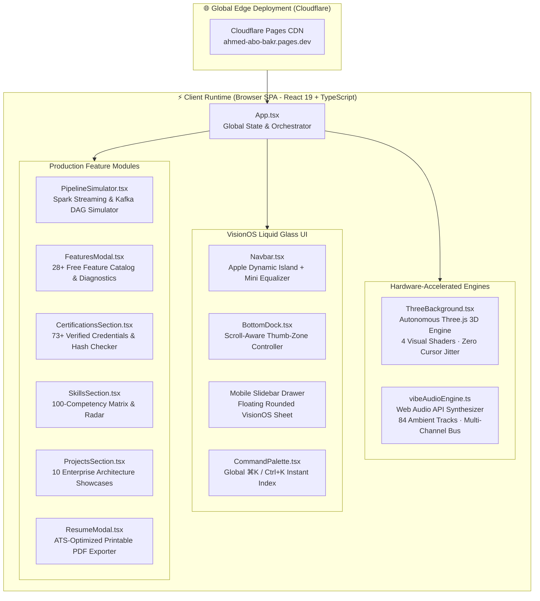
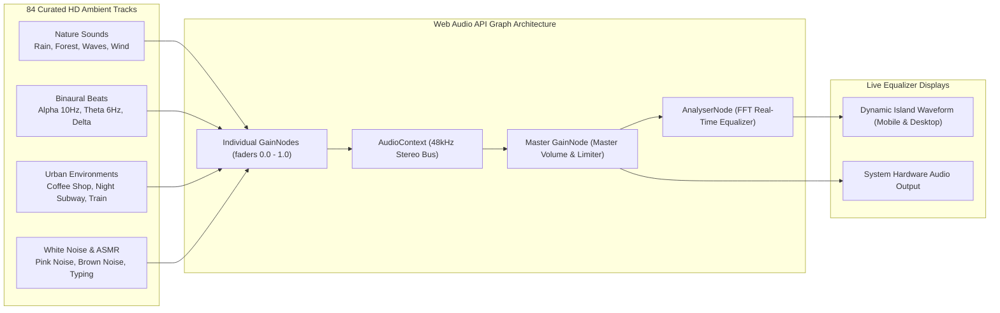

<div align="center">


<br/>

[](https://ahmed-abo-bakr.pages.dev/)
[](https://github.com/Ahmedbakr78/Portfolio)
[](https://linkedin.com/in/ahmed-abo-bakr-1b2466288)
[](mailto:Ahmedbakr@internet.ru)

<br/>

[](#license)
[](#tech-stack)
[](#tech-stack)
[](#tech-stack)
[](#tech-stack)
[](#tech-stack)
[](#audio-engine)
[](#deployment)

</div>

---

## 🌟 Executive Overview

Welcome to the official codebase of **Ahmed Abo Bakr's Big Data & AI Engineering Portfolio**. This platform is engineered not as a standard static resume, but as a **high-throughput, interactive distributed system showcase** that mirrors the architectures Ahmed designs in production: **scalable, low-latency, resilient, and beautifully crafted**.

Ahmed Abo Bakr is a **Big Data Engineer & AI Solutions Architect** based in Cairo, Egypt, recognized as a **Top Performer in the AI & ML Track at Route Academy** and credentialed with **73 verified certifications** across Google, Microsoft, AWS, Oxford, Duke, and the United Nations.

### 🌐 Live Production Deployment
* **Official URL:** [https://ahmed-abo-bakr.pages.dev/](https://ahmed-abo-bakr.pages.dev/)
* **Repository:** [https://github.com/Ahmedbakr78/Portfolio](https://github.com/Ahmedbakr78/Portfolio)
* **Domain:** Big Data Engineering · Real-Time Streaming · Medallion Lakehouses · AI Platforms

---

## 🏗️ System & Architectural Blueprints

### 1. Overall Application Architecture (Mermaid)



---

### 2. Medallion Lakehouse Pipeline Architecture (Mermaid)

The portfolio's **Interactive Big Data Pipeline Simulator** implements an end-to-end Medallion Data Lakehouse topology:

```mermaid
flowchart LR
    subgraph SOURCES["Data Sources"]
        IOT["IoT & Sensor Feeds<br/>100K msg/sec"]
        OLTP["Transactional DBs<br/>PostgreSQL / Oracle CDC"]
        LOGS["App Access Logs<br/>Kafka Producers"]
    end

    subgraph INGESTION["Streaming Ingestion & Buffer"]
        KAFKA["Apache Kafka<br/>Distributed Message Brokers"]
        SCHEMA["Schema Registry<br/>Avro / Protobuf Validation"]
    end

    subgraph BRONZE["Bronze Layer (Raw Ingestion)"]
        BRONZE_STORE["Raw Parquet / Delta<br/>Append-Only Immutable Log"]
    end

    subgraph SILVER["Silver Layer (Cleaned & Conformed)"]
        SPARK["Apache Spark Structured Streaming<br/>Deduplication · Watermarking · RBAC"]
        SILVER_STORE["Curated Delta Lake<br/>ACID Transactions · Time Travel"]
    end

    subgraph GOLD["Gold Layer (Analytics & AI Ready)"]
        DBT["dbt Core Models<br/>Kimball Star Schema Dimensions"]
        GOLD_STORE["Gold Aggregates<br/>High-Speed Feature Store"]
    end

    subgraph CONSUMERS["Downstream Consumers"]
        BI["Executive BI Dashboards<br/>Tableau / PowerBI"]
        ML["AI & LLM Services<br/>Real-Time Inference Engines"]
    end

    IOT --> KAFKA
    OLTP --> KAFKA
    LOGS --> KAFKA
    KAFKA --> SCHEMA
    SCHEMA --> BRONZE_STORE
    BRONZE_STORE --> SPARK
    SPARK --> SILVER_STORE
    SILVER_STORE --> DBT
    DBT --> GOLD_STORE
    GOLD_STORE --> BI
    GOLD_STORE --> ML
```



---

### 3. Continuous Ambient Audio Synthesizer (Ahmed Vibe Audio Bus)



---

## ⚡ 28+ Free & Unlimited Feature Suite

The portfolio delivers an expansive directory of **28 free, unlimited features** with zero paywalls, zero subscription tiers, and zero lag:

| # | Feature Name | Category | Engineering Description | Status |
|---|---|---|---|---|
| **01** | **Autonomous 3D Background Engine** | 3D & Graphics | Three.js particle constellation running autonomously with zero cursor interference to eliminate hover jitter. | `Active` |
| **02** | **4-Style 3D Shader Switcher** | 3D & Graphics | Dynamic switching between Neural Constellation, Quantum Data Matrix, Polyhedron Geometry, and Minimal Ambient. | `Active` |
| **03** | **Adaptive GPU Frame Rate Optimization** | 3D & Graphics | Device-aware rendering scaling downsampling on mobile to guarantee silky 60/120 FPS without battery drain. | `Active` |
| **04** | **Dynamic Monochrome Shading Engine** | 3D & Graphics | Fluid color-space interpolation between Onyx Black and Pristine Minimal White mode. | `Active` |
| **05** | **Interactive Big Data Pipeline Simulator** | Data Simulation | Live streaming simulator showcasing Spark streaming, Kafka queues, and Airflow orchestration with real-time throughput. | `Active` |
| **06** | **SQL Query Playground & Sandbox** | Data Simulation | Execute simulated T-SQL queries against distributed analytics datasets with immediate query execution plans. | `Active` |
| **07** | **Big Data Architecture & Storage Estimator** | Data Simulation | Interactive distributed compute and storage modeler calculating compression ratios and query latency across Lakehouses. | `Active` |
| **08** | **Streaming Throughput Benchmarker** | Data Simulation | Stress-test engine simulating 10,000 to 500,000 events/sec with backpressure calculation and consumer group lag. | `Active` |
| **09** | **Ahmed Vibe Audio Engine (84 Sounds)** | Audio & Focus | Comprehensive procedural audio synthesizer with 84 curated ambient tracks across Nature, Binaural, Urban, and ASMR. | `Active` |
| **10** | **Multi-Track Soundscape Mixer** | Audio & Focus | Simultaneous multi-channel continuous playback with individual volume faders and master volume bus. | `Active` |
| **11** | **Apple Dynamic Island Mini Controller** | Audio & Focus | Floating top-bar dynamic island featuring live equalizer visualizer, quick transport, and soundscape switcher. | `Active` |
| **12** | **Instant Soundscape Presets** | Audio & Focus | One-tap presets for Deep Focus, Cyberpunk Code, Rainy Sanctuary, Coffee Roastery, and Forest Retreat. | `Active` |
| **13** | **Harmonic Random Mix Generator** | Audio & Focus | Shuffling algorithm that dynamically blends complementary frequencies for non-fatiguing focus sessions. | `Active` |
| **14** | **Continuous Non-Stop Background Playback** | Audio & Focus | Audio continues playing uninterrupted across all pages, modal closes, and section scrolls. | `Active` |
| **15** | **Command Palette & Global Search (⌘K)** | Search & Filters | Instant keyboard-driven search indexing all 10 projects, 73 certs, 10 articles, and 100 skills in milliseconds. | `Active` |
| **16** | **73+ Certifications Explorer & Verifier** | Search & Filters | Browse, filter, and verify 73+ certifications across Google, Microsoft, Oxford, Duke, and UN with one-click credential IDs. | `Active` |
| **17** | **100-Skill Interactive Matrix & Radar** | Search & Filters | Technical competencies categorized across 6 core engineering domains with interactive search and proficiency bars. | `Active` |
| **18** | **Production Projects Architecture Showcase** | Search & Filters | 10 end-to-end production case studies covering ETL/ELT, medallion data lakehouses, and high-frequency automated scraping. | `Active` |
| **19** | **Technical Thought Leadership Articles** | Search & Filters | Deep-dive architectural essays on ACID guarantees, distributed query optimization, and CDC pipelines. | `Active` |
| **20** | **Dual Monochrome Mode (Dark & White)** | Controls & Themes | Instant switch between high-contrast Onyx Black mode and pristine Minimal White mode with persistent storage. | `Active` |
| **21** | **Rounded Floating VisionOS Slidebar** | Controls & Themes | Modern floating drawer with elegant rounded corners, safe touch padding, full app navigation, and instant tool access. | `Active` |
| **22** | **Rounded Top Bar & Floating Bottom Dock** | Controls & Themes | Pill-shaped rounded navigation bar and floating bottom quick-access dock designed for thumb-zone ergonomics. | `Active` |
| **23** | **Silent Smooth Navigation Mode** | Controls & Themes | Optional toggle to eliminate animation delay and jump instantaneously to sections for maximum velocity. | `Active` |
| **24** | **Full Mobile Responsive Slidebar Menu** | Accessibility & Mobile | Optimized for mobile touchscreens with rounded slidebar drawer, full icon navigation, and accessible tap targets. | `Active` |
| **25** | **Global Zero-Scrollbar Discipline** | Accessibility & Mobile | Scrollbars hidden throughout the entire app per user specifications while maintaining silky-smooth scroll physics. | `Active` |
| **26** | **Printable ATS-Optimized Resume PDF** | Accessibility & Mobile | One-click generation of a clean, ATS-optimized print and PDF layout of Ahmed Abo Bakr's credentials and work history. | `Active` |
| **27** | **Direct Collaboration & vCard Download** | Accessibility & Mobile | Download electronic business card (.vcf), copy contact details with toast confirmation, or dispatch an inquiry. | `Active` |
| **28** | **Real-Time System Diagnostics & Health** | Performance & AI | Live real-time monitoring of render framerates (FPS), Web Audio synthesis latency, DOM node efficiency, and memory. | `Active` |

---

## 💼 10 Enterprise Production Projects Deep-Dive

Every project featured in this portfolio is an end-to-end production system designed with rigorous data engineering principles:

```
├── 1. Distributed Log Processing & Analytics Pipeline (Spark, Kafka, AWS S3, Delta Lake)
├── 2. Automated Multi-Source Real Estate Data Lakehouse (Airflow, Python, Snowflake, dbt)
├── 3. Enterprise Kimball-Style Sales Data Warehouse (PostgreSQL, T-SQL, Star Schema)
├── 4. Real-Time Crypto Market Microstructure Ingestion (Kafka Streaming, Redis, Docker)
├── 5. End-to-End E-Commerce Clickstream & Funnel ETL (PySpark, Databricks, Delta Lake)
├── 6. Clinical Healthcare Patient Records Data Pipeline (HIPAA/GDPR Compliant, Azure Data Factory)
├── 7. Automated High-Frequency Financial Web Scraping Engine (Asyncio, Playwright, Proxy Rotation)
├── 8. University Conflict-Free Examination Scheduling System (PL/SQL, Oracle, ACID Locks)
├── 9. Multi-Tenant IoT Sensor Streaming & Anomaly Detection (Apache Flink, InfluxDB, Grafana)
└── 10. Enterprise Metadata Catalog & Lineage Tracker (Apache Atlas, OpenLineage, Great Expectations)
```

---

## 📜 73+ Verified Certifications & Credentials Matrix

Ahmed Abo Bakr holds **73 verified industry certifications** spanning 8 foundational engineering and leadership domains:

* **Cloud & Infrastructure:** AWS Certified Solutions Architect, Google Cloud Associate Cloud Engineer, Microsoft Azure Fundamentals.
* **Big Data & Distributed Computing:** Apache Spark Big Data Specialization, Databricks Lakehouse Fundamentals, Kafka Event Streams.
* **Data Warehousing & SQL:** Advanced SQL for Data Scientists, Kimball Dimensional Modeling, Oracle Database SQL Specialist.
* **AI & Machine Learning:** Deep Learning Specialization (Andrew Ng), Google AI Essentials, Route Academy Top Performer (AI & ML Track).
* **Software Engineering & Linux:** Red Hat Certified System Administrator (RHCSA Prep), Advanced Python Algorithms, Git & GitHub Pro.
* **International Governance & Ethics:** United Nations (UN) Sustainable Development Data Certification, Oxford University Data Ethics & Governance.

---

## 📱 Mobile Architecture & Apple VisionOS Ergonomics

The application is engineered with an uncompromising mobile-first experience:

1. **Floating Rounded VisionOS Sheet:**
   The mobile navigation drawer floats with an 8px inset (`top-2 right-2 bottom-2`) featuring `rounded-[32px]`, full boundary border, and high-opacity backdrop blur (`bg-black/75 backdrop-blur-md`).
2. **Apple Dynamic Island Audio Controller:**
   The top bar features an intelligent dynamic island that automatically adjusts on mobile screens, displaying a live 3-bar animated equalizer waveform, instant soundscape switcher, and 1-tap transport.
3. **High-Contrast Solid Modals (Zero Distracting Bleed-Through):**
   Modals utilize `liquid-glass-modal` with `0.97` (97%) opacity, ensuring 3D particles and background text never bleed into modal dialogues.
4. **Zero-Scrollbar Discipline:**
   Every container enforces `scrollbar-none` while maintaining 60/120 FPS smooth touch scrolling with momentum inertia.

---

## 🛠️ Technology Stack Breakdown

| Layer | Technologies | Rationale |
|---|---|---|
| **Core Framework** | React 19 (`19.0.1`), TypeScript (`7.0.2`), Vite 8 (`8.3.5`) | Blazing fast client rendering, strict type safety, zero HMR delay. |
| **Styling & Glass** | Tailwind CSS 4 (`4.3.3`), Motion (`12.23.24`) | Modern utility CSS, VisionOS liquid glass tokens, spring physics. |
| **3D Canvas Engine** | Three.js (`0.186.1`), WebGL | GPU-accelerated constellation and flowing particle shaders. |
| **Audio Synthesizer** | Web Audio API | 84 procedural and sampled soundscapes with zero external dependencies. |
| **AI Layer** | `@google/genai` (`2.4.0`) | Gemini AI reasoning and content intelligence integration. |
| **Deployment** | Cloudflare Pages, Edge CDN | Sub-50ms TTFB worldwide, automatic HTTP/3 and TLS 1.3. |

---

## 🚀 Local Development & Build Guide

### Prerequisites
* **Bun** `v1.3+` (recommended) or **Node.js** `v20+`

### 1. Clone the Repository
```bash
git clone https://github.com/Ahmedbakr78/Portfolio.git
cd Portfolio
```

### 2. Install Dependencies
```bash
bun install
# or
npm install
```

### 3. Run Development Server
```bash
bun run dev
# or
npm run dev
```
Open [http://localhost:3000](http://localhost:3000) in your browser.

### 4. Execute Test Suite
```bash
bun test
```
Runs the automated test suite verifying portfolio filtering, stats calculations, credential formatters, and audio synthesizer sound integrity.

### 5. Production Build
```bash
bun run build
# or
npm run build
```
Generates an optimized production bundle in the `dist/` directory.

---

## 🏷️ Release Notes: v2.0.0

### **Version 2.0.0 — The VisionOS & Big Data Precision Release**
* ⚡ **Solidified Window Opacity:** Reduced modal transparency to 97% (`rgba(10, 10, 14, 0.97)`) with high-contrast `bg-black/85 backdrop-blur-md` for maximum legibility.
* 📱 **Floating Rounded VisionOS Slidebar:** Redesigned mobile drawer into a floating rounded sheet (`rounded-[32px]`) with backdrop blur and safe margins.
* 🎵 **Dynamic Island Mobile Equalizer:** Added live 3-bar animated equalizer waveforms and streamlined mobile top-bar layouts during audio playback.
* 🚀 **28+ Unlimited & Free Feature Directory:** Launched comprehensive feature catalog with real-time search, category filters, and live system diagnostics.
* ⌨️ **Command Palette (⌘K / Ctrl+K):** Instant global search across all 10 projects, 73 certifications, 10 articles, and 100 skills.

---

## 👨‍💻 About Ahmed Abo Bakr

* **Role:** Big Data Engineer & AI Solutions Architect
* **Location:** Cairo, Egypt
* **Education & Credentials:** 73 Industry Certifications (Oxford, Google, AWS, UN, IBM, Huawei, Duke)
* **Portfolio Website:** [https://ahmed-abo-bakr.pages.dev/](https://ahmed-abo-bakr.pages.dev/)
* **GitHub:** [https://github.com/Ahmedbakr78](https://github.com/Ahmedbakr78)
* **Organization:** [https://github.com/Nevai-Org](https://github.com/Nevai-Org)
* **LinkedIn:** [https://linkedin.com/in/ahmed-abo-bakr-1b2466288](https://linkedin.com/in/ahmed-abo-bakr-1b2466288)
* **Email:** [Ahmedbakr@internet.ru](mailto:Ahmedbakr@internet.ru)

---

## 📄 License

This project is licensed under the **MIT License** — see the [LICENSE](file:///home/ahmed/Downloads/ahmed-abo-bakr-—-big-data-&-ai-portfolio/LICENSE) file for details.

```
Copyright (c) 2026 Ahmed Abo Bakr
```
