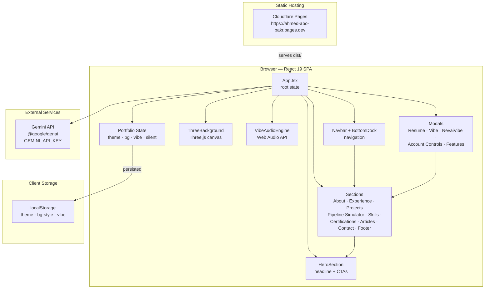
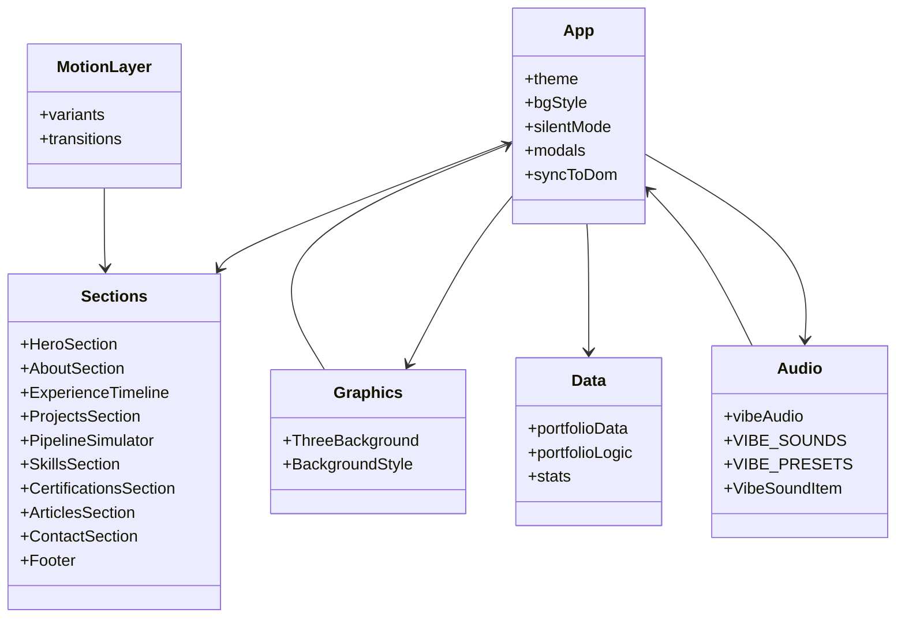
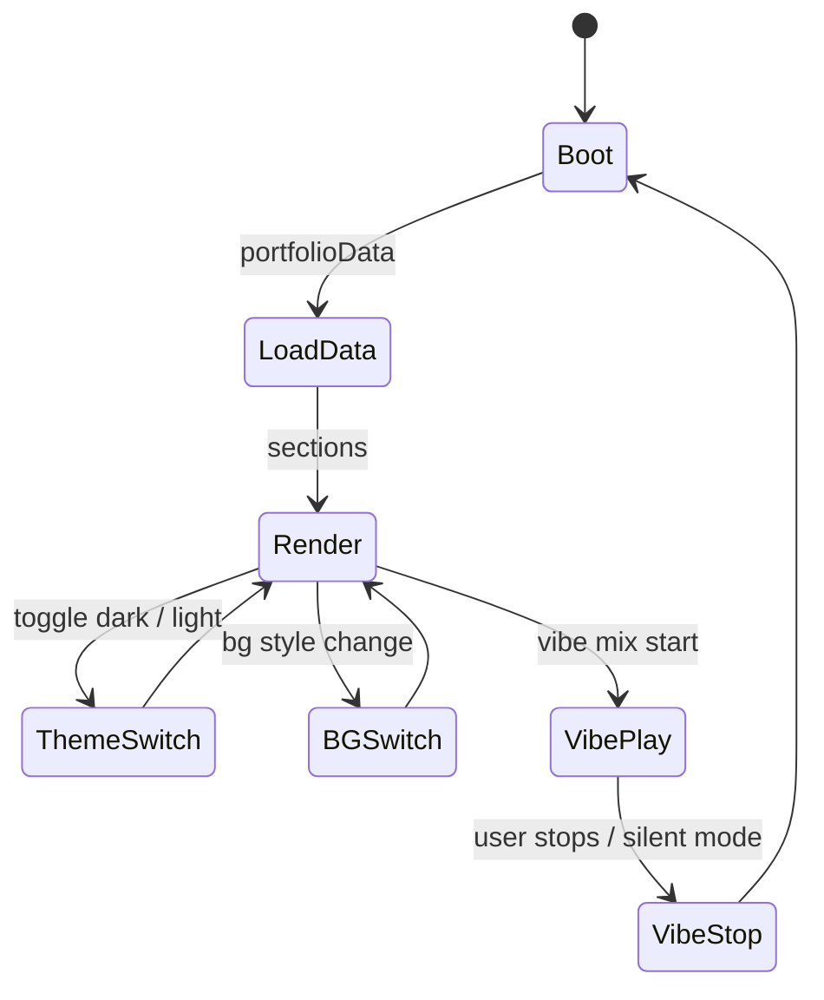

<div align="center">


**The personal engineering portfolio of Ahmed Abo Bakr — Big Data Engineer, Cloud Architect & AI Solutions Specialist.**

[Live Site](https://ahmed-abo-bakr.pages.dev/) · [GitHub](https://github.com/Ahmedbakr78/Portfolio) · [LinkedIn](https://linkedin.com/in/ahmed-abo-bakr-1b2466288) · [Email](mailto:Ahmedbakr@internet.ru)

<br/>

[](#license)
[](#tech-stack)
[](#tech-stack)
[](#tech-stack)
[](#tech-stack)
[](#tech-stack)
[](#tech-stack)
[](#deployment)

<br/>

| **Live App** | **Stack** | **Focus** | **Status** |
|---|---|---|---|
| [](https://ahmed-abo-bakr.pages.dev/) | React 19 · Vite 8 · TS · Tailwind 4 · Three.js | Big Data · AI · Cloud | [](https://github.com/Ahmedbakr78/Portfolio/actions) |

</div>

---

## What Is This Repository?

This repository contains **Ahmed Abo Bakr's personal engineering portfolio** — a polished, animated, interactive single-page application that presents a **Big Data Engineer**, **Cloud Architect** and **AI Solutions Specialist**.

The portfolio is not a static resume dump. It is a **living product**:

- Animated **Three.js** background with selectable styles
- Continuous ambient **audio engine** (Web Audio API) with vibe mixes, master volume and silent mode
- Deep project content — metrics, architecture notes, tags, stars, forks, demos
- Interactive **pipeline simulator** for big-data flows
- Keyboard-first navigation — navbar, bottom dock and command palette
- Rich **modals** — resume, vibe, AI, account controls, feature showcase
- Dark / Light themes persisted locally
- Content driven by typed data modules with filterable logic

> **Mission:** turn an engineering career into an **experience** — not a document.

---

## The Portfolio at a Glance

| Area | Implementation | Highlights |
|---|---|---|
| **Presentation** | `src/App.tsx` + section components | Hero, About, Experience timeline, Projects, Pipeline Simulator, Skills, Certifications, Articles, Contact, Footer |
| **3D / Graphics** | `src/components/ThreeBackground.tsx` | Three.js canvas background engine with multiple styles |
| **Ambient Audio** | `src/utils/vibeAudioEngine.ts` | Web Audio API vibe mixes, volume control, silent mode |
| **Content** | `src/data/portfolioData.ts` | Typed projects, experiences, certifications, articles, features |
| **Logic** | `src/utils/portfolioLogic.ts` | Filtering, stats calculation, formatting helpers |
| **Navigation** | `src/components/Navbar.tsx`, `BottomDock.tsx`, `CommandPalette.tsx` | Sections, quick commands, keyboard-first |
| **AI** | `@google/genai` + `GEMINI_API_KEY` | Gemini-powered capability layer (server-side architecture in AI Studio metadata) |

---

## Why the Portfolio Exists

Ahmed Abo Bakr is a **Big Data Engineer** who designs data platforms, real-time streaming pipelines and AI solutions.

The best proof of that is a portfolio that **behaves** like the systems he designs — scalable, real-time, interactive and fast.

The portfolio demonstrates:

1. **Architectural thinking** — every project carries metrics, architecture notes and tags.
2. **Big Data depth** — Spark, Kafka, Airflow, SQL, warehouses, streaming, lakehouses.
3. **AI + Data fusion** — LLM-powered features, applied ML content, intelligent pipelines.
4. **Cloud & security** — AWS / Azure, RBAC, AES-256, inference control, governance.
5. **Craft** — motion, 3D, audio, themes, keyboard navigation.

---

## Architecture

### System Architecture



### Anatomy of the Frontend



### State & Data Flow



---

## Features

### Immersive Experience
- Animated **Three.js** background with selectable styles (constellation, grid, ...).
- Continuous ambient **audio engine** (Web Audio API) with multiple vibe mixes, master volume and silent mode.
- Motion-driven animations via the `motion` library.

### Product & Content Depth
- **Hero** with headline, CTAs and quick stats.
- **About** with bio, focus areas and certifications snapshot.
- **Experience timeline** — roles, achievements, skills.
- **Projects** — filterable by category, each with tags, stars, forks, metrics, architecture notes, demo links.
- **Pipeline Simulator** — interactive big-data pipeline walkthrough.
- **Skills** — grouped skills matrix.
- **Certifications** — featured credentials with issuer, date, credential ID and skills.
- **Articles** — engineering write-ups with summaries and content.
- **Contact** — social / email links.

### Interaction & Accessibility
- **Navbar** + **BottomDock** + **CommandPalette** — keyboard-first navigation.
- **Modals** — Resume, Vibe, NevaiVibe, Account Controls, Features.
- **Dark / Light** theme with persistence.

---

## Tech Stack

| Layer | Technology |
|---|---|
| UI framework | React 19 |
| Build tool | Vite 8 |
| Language | TypeScript 7 (native) |
| Styling | Tailwind CSS 4 |
| 3D | Three.js 0.186 |
| Animation | motion 12 |
| Icons | lucide-react |
| AI | @google/genai (Gemini) |
| Audio | Web Audio API |
| Runtime tests | node:test |
| Lint | tsc --noEmit |

---

## Getting Started

### Prerequisites

- **Node.js 20+** (Vite 8 requires `^20.19.0 || >=22.12.0`)
- **npm** or **bun**

### Install

```bash
git clone https://github.com/Ahmedbakr78/Portfolio.git
cd Portfolio
npm install
```

### Environment

```bash
cp .env.example .env.local
# GEMINI_API_KEY="..."
# APP_URL="..."
```

### Run

```bash
npm run dev
```

Open **http://localhost:3000**.

### Build & Preview

```bash
npm run build
npm run preview
```

### Lint

```bash
npm run lint
```

---

## Environment Variables

| Variable | Required | Description |
|---|---|---|
| `GEMINI_API_KEY` | Yes | Gemini AI API key (AI Studio secrets) |
| `APP_URL` | Yes | Public app URL used for self-referential links / callbacks |
| `DISABLE_HMR` | No | Set `true` to disable Vite HMR (AI Studio runtime) |

---

## Deployment

The production app is deployed on **Cloudflare Pages**:

### Web: https://ahmed-abo-bakr.pages.dev/

Deploy flow:

```bash
npm run build
npx wrangler pages deploy dist --project-name ahmed-abo-bakr --branch main
```

---

## Project Structure

```
src/
├── App.tsx
├── main.tsx
├── index.css
├── components/       # UI sections, dock, modals, palette, 3D
├── data/             # portfolio content (typed)
└── utils/            # portfolio logic, vibe audio engine, tests
```

---

## The Story, Releases & Roadmap

### Release History

- **v1.0** — Initial AI Studio app scaffold, evolved into React + Vite + Tailwind + Three.js + Gemini portfolio.

### Roadmap

- AI-assisted content generation integrations
- Server-side rendering / API routes for Gemini
- Performance budget enforcement (code splitting)
- Multi-language / RTL support

---

## About the Builder

**Ahmed Abo Bakr** — Big Data Engineer, Cloud Architect & AI Solutions Specialist based in Cairo, Egypt.

[Portfolio](https://ahmed-abo-bakr.pages.dev/) · [GitHub](https://github.com/Ahmedbakr78) · [LinkedIn](https://linkedin.com/in/ahmed-abo-bakr-1b2466288) · [Email](mailto:Ahmedbakr@internet.ru)

---

## License

MIT © Ahmed Abo Bakr

---

<div align="center">

## Get the Portfolio

[](https://ahmed-abo-bakr.pages.dev/)
[](https://github.com/Ahmedbakr78/Portfolio)

<br/>


<sub>2026 Ahmed Abo Bakr · MIT License · Built with React, Vite, Three.js and Gemini.</sub>

</div>
