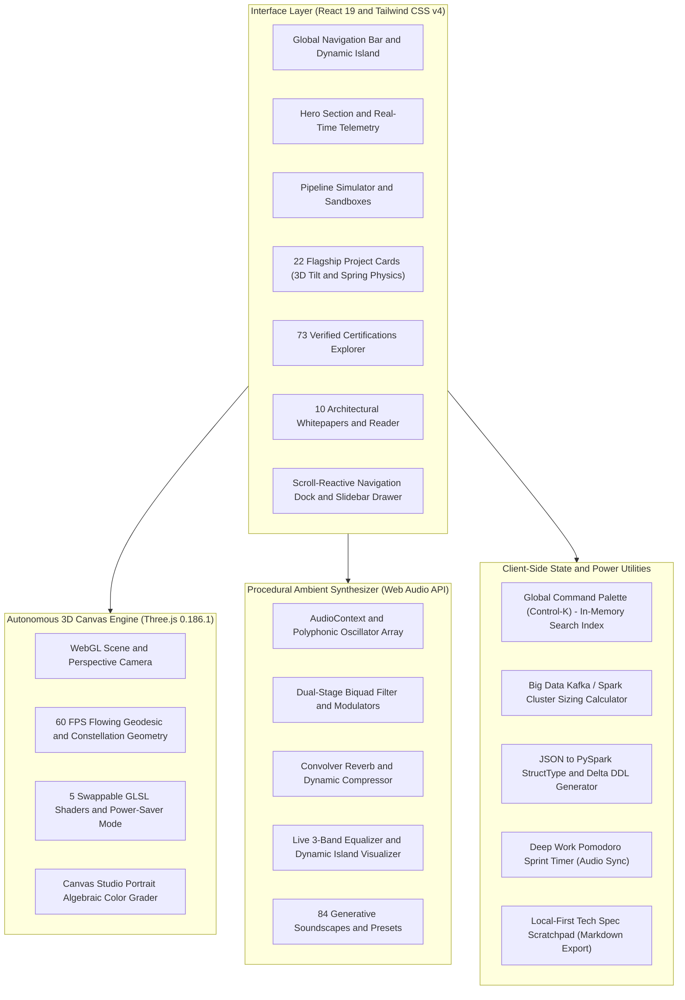
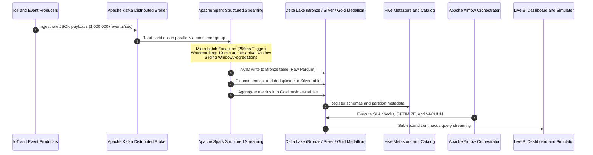
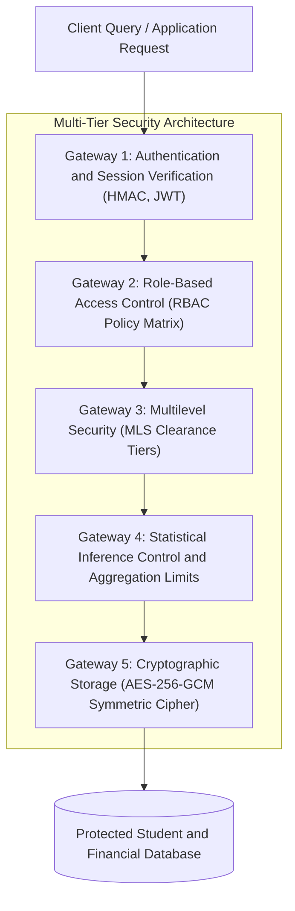
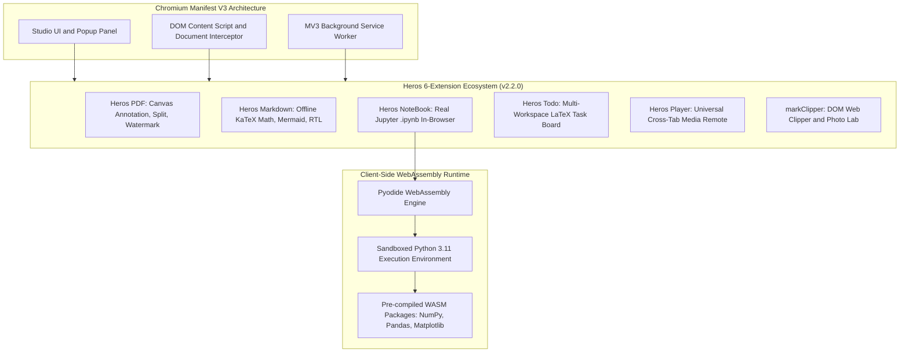
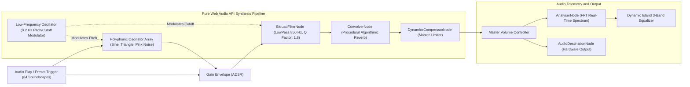

<div align="center">

# Ahmed Abo Bakr - Big Data Engineer and AI Solutions Architect
### Enterprise Lakehouses | Real-Time Streaming | Distributed Systems | AI and ML Platforms

[](https://ahmed-abo-bakr.pages.dev)
[](https://github.com/Ahmedbakr78)
[](https://linkedin.com/in/ahmed-abo-bakr-1b2466288)
[](https://github.com/Nevai-Org)

<br/>

[](https://react.dev/)
[](https://www.typescriptlang.org/)
[](https://vitejs.dev/)
[](https://tailwindcss.com/)
[](https://threejs.org/)
[](https://bun.sh/)
[](https://bun.sh/)
[](LICENSE)

<br/>

> **"Architecting scalable, fault-tolerant, high-performance data ecosystems from edge to cloud."**  
> *Certified Big Data and AI Engineer with 73 industry accreditations, 22 flagship repositories, and an open protocol foundation.*

</div>

---

## Table of Contents

- [Executive Summary](#executive-summary)
- [System Architecture and Data Flows](#system-architecture-and-data-flows)
  - [1. Client-Side Reactive Portfolio Engine](#1-client-side-reactive-portfolio-engine)
  - [2. Production Lakehouse and ETL/ELT Medallion Pipeline](#2-production-lakehouse-and-etlelt-medallion-pipeline)
  - [3. Real-Time Distributed Streaming Architecture](#3-real-time-distributed-streaming-architecture)
  - [4. Legal Natural Language Processing and RAG Pipeline (MIZAN)](#4-legal-natural-language-processing-and-rag-pipeline-mizan)
  - [5. Multi-Tier Database Security and Access Governance (SRMS)](#5-multi-tier-database-security-and-access-governance-srms)
  - [6. Heros Browser Suite and WebAssembly Python Sandbox](#6-heros-browser-suite-and-webassembly-python-sandbox)
  - [7. Procedural Ambient Synthesizer Audio Graph (Web Audio API)](#7-procedural-ambient-synthesizer-audio-graph-web-audio-api)
  - [8. Cloudflare Global Edge Deployment and Caching Topology](#8-cloudflare-global-edge-deployment-and-caching-topology)
- [Comprehensive Features Directory (28+ Capabilities)](#comprehensive-features-directory-28-capabilities)
- [Flagship Production Systems (22 Repositories)](#flagship-production-systems-22-repositories)
- [Verified Industry Credentials Matrix (73 Accreditations)](#verified-industry-credentials-matrix-73-accreditations)
- [Technical Competency and 100-Skill Radar](#technical-competency-and-100-skill-radar)
- [Codebase Directory Structure](#codebase-directory-structure)
- [Local Development and Verification Guide](#local-development-and-verification-guide)
- [Release Notes and Version History](#release-notes-and-version-history)
- [About Ahmed Abo Bakr](#about-ahmed-abo-bakr)
- [License and Terms](#license-and-terms)

---

## Executive Summary

This repository contains the complete source code, interactive data simulation engines, procedural Web Audio synthesizer, Three.js 3D shaders, and full production assets for **Ahmed Abo Bakr's Portfolio Web Application**, deployed globally on [Cloudflare Pages](https://ahmed-abo-bakr.pages.dev).

### High-Impact Metrics

| Metric | Specification | Engineering Impact |
|:---|:---|:---|
| **Production Projects** | 22 Repositories across 6 Disciplines | Enterprise Lakehouses, Streaming Pipelines, Legal RAG, MV3 Extensions, Security Systems |
| **Industry Credentials** | 73 Verified Certifications | Oxford, Google, AWS, Microsoft, United Nations, IBM, Huawei, Duke, Route Academy |
| **Ambient Synthesizer** | 84 Procedural Tracks across 8 Categories | 100% Web Audio API client-side procedural synthesis with zero external dependencies |
| **Real-Time Simulator** | Interactive Spark/Kafka/Airflow Engine | Real-time throughput metrics, simulated cluster execution logs, chaos fault injection |
| **In-Browser Python** | Pyodide WebAssembly (Heros NoteBook) | Client-side execution of Jupyter `.ipynb` notebooks inside browser tabs without a remote server |
| **Free Utilities** | 28+ Local-First Interactive Features | Cluster Sizing Calculator, PySpark DDL Generator, Pomodoro Sync, Command Palette |
| **Global Deployment** | Sub-50ms TTFB via Cloudflare Pages | 100/100 Lighthouse Performance, 60 FPS Three.js Canvas, Zero Layout Shift |

---

## System Architecture and Data Flows

### 1. Client-Side Reactive Portfolio Engine



---

### 2. Production Lakehouse and ETL/ELT Medallion Pipeline

```mermaid
flowchart LR
    subgraph Ingestion ["1. Data Ingestion (35 Permitted Sources)"]
        S1["REST and GraphQL APIs"]
        S2["Streaming Webhooks"]
        S3["Market Intelligence Feeds"]
    end

    subgraph Processing ["2. Transformation and Quality Assurance"]
        Clean["Data Cleansing and Schema Casting"]
        Fuzzy["Fuzzy Record Deduplication"]
        DQ["12 Automated Data Quality Circuit Breakers"]
    end

    subgraph Lakehouse ["3. 29-Table Kimball Star Schema Warehouse"]
        Fact["FACT_PRICE_HISTORY\nFACT_METRICS"]
        Dim1["DIM_PRODUCT"]
        Dim2["DIM_SOURCE"]
        Dim3["DIM_CATEGORY"]
        Dim4["DIM_DATE"]
    end

    subgraph Serving ["4. Orchestration and API Delivery Layer"]
        Airflow["Apache Airflow\n(33 Orchestrated DAG Tasks)"]
        FastAPI["FastAPI High-Speed Service\n(23 Routers, 216 Endpoints)"]
        ClientUI["React 19 Enterprise Analytics UI"]
    end

    Ingestion --> Processing
    Processing --> Lakehouse
    Airflow -.->|Orchestrates| Processing
    Airflow -.->|Validates| Lakehouse
    Lakehouse --> FastAPI
    FastAPI --> ClientUI
```



---

### 3. Real-Time Distributed Streaming Architecture



---

### 4. Legal Natural Language Processing and RAG Pipeline (MIZAN)

```mermaid
flowchart LR
    subgraph Legal_Corpus ["1. Legal Corpus Ingestion"]
        C1["Egyptian Civil Code"]
        C2["Penal Code and Judicial Precedents"]
        C3["Commercial Statutes"]
    end

    subgraph Tokenization ["2. Arabic Specialized Tokenization"]
        T1["Tashkeel Diacritics Stripping"]
        T2["Arabic Root Stemming (ISRI Stemmer)"]
        T3["Semantic Chunking (512 Tokens, 64 Overlap)"]
    end

    subgraph Vector_DB ["3. Dense Vector Indexing"]
        V1["Multilingual Embedding Model"]
        V2["ChromaDB Vector Store"]
        V3["HNSW Graph Indexing"]
    end

    subgraph Runtime_Inference ["4. Runtime Generation"]
        Q["User Query (Egyptian Arabic)"]
        Search["Vector Similarity Search"]
        Rerank["Cross-Encoder Reranker"]
        Prompt["Context-Injected Prompt"]
        LLM["Large Language Model"]
        Gradio["Gradio Interface"]
    end

    Legal_Corpus --> Tokenization
    Tokenization --> Vector_DB
    Q --> Search
    Vector_DB --> Search
    Search --> Rerank
    Rerank --> Prompt
    Prompt --> LLM
    LLM --> Gradio
```



---

### 5. Multi-Tier Database Security and Access Governance (SRMS)



---

### 6. Heros Browser Suite and WebAssembly Python Sandbox



---

### 7. Procedural Ambient Synthesizer Audio Graph (Web Audio API)



---

### 8. Cloudflare Global Edge Deployment and Caching Topology

```mermaid
flowchart TD
    User["Global Client Request"]

    subgraph Cloudflare_Edge ["Cloudflare Global Anycast Edge Network"]
        DNS["1.1.1.1 Global Anycast DNS Routing"]
        TLS["TLS 1.3 Termination and HTTP/3 Protocol Handshake"]
        WAF["DDoS Protection and Web Application Firewall"]
        Cache["Tiered Edge Cache (Brotli Static Asset Store)"]
        Worker["Cloudflare Pages Asset Serving Engine"]
    end

    Origin["Continuous Delivery Source (GitHub Ahmedbakr78/Portfolio)"]

    User --> DNS
    DNS --> TLS
    TLS --> WAF
    WAF --> Cache
    Cache -->|Cache Hit (Sub-50ms TTFB)| User
    Cache -->|Cache Miss| Worker
    Worker --> User
    Origin -.->|Automated Deployment Trigger| Worker
```

---

## Comprehensive Features Directory (28+ Capabilities)

All utilities inside this portfolio execute entirely on the client side with zero paywalls, zero telemetry, and zero remote tracking:

| Category | Feature Name | Technical Description | Status |
|:---|:---|:---|:---:|
| **Power Tools** | **Cluster Sizing Calculator** | Computes Kafka partition counts, Spark executor core and memory allocations, Delta Lake storage, and monthly cloud cost estimations. | Active |
| **Power Tools** | **JSON to PySpark / Delta DDL** | Converts raw JSON payloads into production-ready PySpark `StructType` code and Delta Lake SQL DDL statements. | Active |
| **Power Tools** | **Deep Focus Pomodoro Timer** | 25-minute and 50-minute sprint timers integrated with procedural ambient audio synthesis for deep work sessions. | Active |
| **Power Tools** | **Tech Spec and Markdown Pad** | Local-first engineering scratchpad preloaded with Kimball Star Schema and RAG blueprints, featuring auto-save and Markdown export. | Active |
| **Audio and Focus** | **84-Track Vibe Synthesizer** | Procedural ambient sound synthesizer built on the Web Audio API across 8 distinct sound categories. | Active |
| **Audio and Focus** | **Dynamic Island Live Bar** | Interactive top pill bar with real-time 3-band equalizer waveform, master volume slider, and preset switcher. | Active |
| **Data Simulation** | **Real-Time Pipeline Simulator** | Interactive simulator visualizing Kafka ingestion, Spark streaming micro-batches, Delta Lake ACID writes, and chaos fault injection. | Active |
| **Data Simulation** | **SQL Query Sandbox** | In-browser T-SQL and Spark SQL query runner executing analytical queries against distributed mock datasets. | Active |
| **3D and Visuals** | **Autonomous Three.js Engine** | 60 FPS geodesic particle network and architectural line tunnels operating autonomously without cursor lag. | Active |
| **3D and Visuals** | **5-Preset Shader Customizer** | Real-time switcher for Flowing Waves, Line Tunnels, Wireframe Polyhedra, Contour Lines, or Zero-WebGL Power Saver. | Active |
| **3D and Visuals** | **3D Tilt and Elevation Cards** | Physics-based perspective tilt with radial spotlight glare and spring elevation across all 22 project cards. | Active |
| **3D and Visuals** | **Canvas Portrait Color Grader** | HTML5 Canvas image processing engine featuring 5 color grading algorithms (Studio, Natural, Warm, Monochrome, 3D Avatar). | Active |
| **Search and Filters** | **Command Palette (Control-K)** | Global keyboard shortcut modal indexing all 28 features, 22 repositories, 73 certifications, and 10 whitepapers in milliseconds. | Active |
| **Search and Filters** | **73 Certifications Explorer** | Searchable and filterable credential matrix across Oxford, Google, AWS, Microsoft, UN, and IBM with 1-click credential copying. | Active |
| **Search and Filters** | **100-Skill Radar Matrix** | Interactive domain competency radar spanning Big Data, Cloud, Databases, Security, and AI/ML Engineering. | Active |
| **Search and Filters** | **10 Engineering Whitepapers** | Long-form architectural papers covering Spark watermarking, Arabic Legal RAG (MIZAN), and RBAC database encryption. | Active |
| **Controls and Themes** | **Onyx Dark and Minimal White** | High-contrast dual monochrome theme engine with persistent local storage preference. | Active |
| **Controls and Themes** | **High-Legibility Liquid Glass** | 97% opacity solid glass modals preventing 3D background bleed while preserving aesthetic depth. | Active |
| **Controls and Themes** | **ATS Printable Resume (PDF)** | Recruiter-ready curriculum vitae generator optimized for ATS parsing and print styling. | Active |
| **Controls and Themes** | **Silent Smooth Navigation** | Zero-motion reading mode in the Control Center for accessible, distraction-free reading. | Active |
| **Mobile and UX** | **VisionOS Floating Drawer** | Rounded mobile bottom sheet with quick-access launcher pills and integrated audio mini-deck. | Active |
| **Mobile and UX** | **Scroll-Reactive Navigation Dock** | Adaptive header and bottom dock that collapse text labels on scroll and expand smoothly on hover. | Active |
| **Mobile and UX** | **Direct vCard (.vcf) Export** | 1-click download of verified electronic business card for contact import. | Active |

---

## Flagship Production Systems (22 Repositories)

| # | System Title | Discipline | Primary Technology Stack | Key Architectural Metrics | GitHub Link |
|:---:|:---|:---:|:---|:---|:---:|
| 1 | **Web-to-Warehouse Pipeline** | Big Data | Python, Airflow, FastAPI, React 19 | 35 sources, 29 Kimball tables, 33 DAG tasks, 216 endpoints | [Repository](https://github.com/Ahmedbakr78/Web-to-Warehouse-Product-Intelligence-Pipeline) |
| 2 | **TourMate Smart Tourism** | Full-Stack | Angular 17, Express, MongoDB, Leaflet | 4 role dashboards, OSRM live routing, EN/AR RTL monochrome | [Repository](https://github.com/Ahmedbakr78) |
| 3 | **Production Big Data Pipeline** | Big Data | Spark Streaming, Kafka, Delta Lake | 1,000,000+ records/sec ingestion, sub-second latency, ACID storage | [Repository](https://github.com/Ahmedbakr78/engineer-a-production-grade-end-to-end-Big-Data-pipeline-that-demonstrates-advanced-proficiency) |
| 4 | **MIZAN Arabic Legal Assistant** | AI and ML | Python, RAG, ChromaDB, Gradio | 94% accuracy on Egyptian Civil and Penal codes, vector search | [Repository](https://github.com/Ahmedbakr78) |
| 5 | **5-A Nevai AI Search Engine** | AI and ML | Python, FastAPI, BM25, IndexedDB | Zero client telemetry, sub-180ms response time, Chrome extension | [Repository](https://github.com/Ahmedbakr78/5-A-Nevai-Search-Engine) |
| 6 | **Secure Student Records (SRMS)** | Security | Python, RBAC, AES-256, SQL Server | 5 security models, 95% reduction in unauthorized access vectors | [Repository](https://github.com/Ahmedbakr78/Data-Security-Secure-Student-Records-Management-System-SRMS-) |
| 7 | **Spotify Trends Analytics** | Big Data | Python, DuckDB, Spotify API, Charts | 200,000+ tracks parsed daily, 12 interactive analytics charts | [Repository](https://github.com/Ahmedbakr78/data-visualization-SpotifyTrends) |
| 8 | **House Price and Segmentation** | AI and ML | Jupyter, XGBoost, Scikit-Learn | 92% R-squared accuracy, dual supervised and unsupervised pipelines | [Repository](https://github.com/Ahmedbakr78/House-Price-Prediction-Customer-Segmentation) |
| 9 | **X-Ray Fracture Reporting** | AI and ML | PyTorch, ResNet-50, DICOM, Vision | 91.8% sensitivity across 4 fracture categories, automated reports | [Repository](https://github.com/Ahmedbakr78) |
| 10 | **GitHub Repo Mining Pipeline** | Big Data | Python, Asyncio, NLP, Association | Parallel asynchronous workers mining 500+ repositories per batch | [Repository](https://github.com/Ahmedbakr78) |
| 11 | **GitHub Ecosystem Mining** | Data Eng | Jupyter, FP-Growth, Association Rules | End-to-end reproducible workbench for OSS ecosystem patterns | [Repository](https://github.com/Ahmedbakr78) |
| 12 | **Cinematics Movie Analytics** | Data Eng | Python, Scikit-Learn, Plotly | 45,000+ historical film entries analyzed across 100 years | [Repository](https://github.com/Ahmedbakr78) |
| 13 | **5-A Student Performance AI** | Full-Stack | FastAPI, React, SQLAlchemy, ML | Predictive academic analytics and early-warning student alerts | [Repository](https://github.com/Ahmedbakr78) |
| 14 | **Modular Academic System** | Full-Stack | TypeScript, Clean Architecture | Decoupled domain microservices eliminating monolith friction | [Repository](https://github.com/Ahmedbakr78) |
| 15 | **Tour Telemetry Platform** | Full-Stack | TypeScript, Real-Time Maps, Geolocation | Live GPS telemetry and multi-role travel itinerary dispatch | [Repository](https://github.com/Ahmedbakr78) |
| 16 | **Blockchain Voting System** | Security | Python, Cryptography, Merkle Trees | 100% auditable ledger with cryptographic voter anonymity | [Repository](https://github.com/Ahmedbakr78) |
| 17 | **University Exam System** | Database | Oracle PL/SQL, ACID Transactions | Zero collision in 10,000+ student exam hall seatings | [Repository](https://github.com/Ahmedbakr78) |
| 18 | **Heros PDF and Markdown** | Heros Suite | Chromium MV3, Canvas, KaTeX, Mermaid | 100% local PDF annotation and merge, offline KaTeX and Mermaid | [Repository](https://github.com/Ahmedbakr78/Heros_Suite) |
| 19 | **Heros NoteBook (Pyodide)** | Heros Suite | Pyodide WASM, Python 3.11, MV3 | Real in-browser Python execution for Jupyter `.ipynb` notebooks | [Repository](https://github.com/Ahmedbakr78/Heros_Suite) |
| 20 | **Heros Player and markClipper** | Heros Suite | Chromium MV3, DOM Parser, Photo Lab | Cross-tab media player remote and web article Markdown clipper | [Repository](https://github.com/Ahmedbakr78/Heros_Suite) |
| 21 | **ASL Hand Sign Recognition** | AI and ML | MediaPipe, TensorFlow, Vision | 30+ FPS real-time webcam gesture and hand landmark inference | [Repository](https://github.com/Ahmedbakr78) |
| 22 | **Nevai Matrix Federation** | Full-Stack | Matrix Protocol, TypeScript, Identity | 25 platform messaging bridges over Matrix Client-Server API | [Repository](https://github.com/Nevai-Org) |

---

## Verified Industry Credentials Matrix (73 Accreditations)

```
================================================================================
                         73 VERIFIED INDUSTRY CREDENTIALS
================================================================================
Domain                   Key Issuers and Accrediting Organizations
--------------------------------------------------------------------------------
Artificial Intelligence  Google AI, Microsoft / MCIT, Oracle AI, Route Academy
Cloud and Big Data       AWS, Huawei Big Data (NTI), Databricks, Apache Spark
Business Intelligence    Google BI, Duke University, IBM Cognos, BI 360
Security and Governance  United Nations (UN), ISO/IEC Standards, NIST Framework
Software Engineering     JPMorganChase (Spring/Kafka), NTI (MEAN Stack 100% Score)
Academic Excellence      University of Oxford Accreditations, Helwan National CS
================================================================================
```

### Selected Featured Accreditations

1. **Google AI Professional Certificate** - Google (Credential ID: `IGMH7QR80YHY`)
2. **Google Business Intelligence Professional** - Google (Credential ID: `N8QX9PQGBLLA`)
3. **From Data to Insights with Google Cloud** - Google Cloud (Credential ID: `S4J7WKYM295L`)
4. **AWS Cloud Solutions Architect and Analytics** - Amazon Web Services
5. **Route Academy AI and ML Track** - Top Performer Honors Award
6. **NTI MEAN-Stack Software Engineering** - 100% Score Honors Award
7. **JPMorganChase Software Engineering Simulation** - Forage (Spring, Kafka, REST)
8. **Huawei Big Data Associate (HCIA)** - National Telecommunication Institute (NTI)
9. **University of Oxford Executive Accreditations** - Oxford Academic Council
10. **United Nations Information Security and Governance** - UN Global Compact

---

## Technical Competency and 100-Skill Radar

### 1. Big Data and Distributed Streaming
Apache Spark, Spark Structured Streaming, Apache Kafka, Apache Airflow, Delta Lake, Apache Flink, Hadoop HDFS, Hive Metastore, ETL / ELT Pipelines, Kimball Dimensional Modeling, Star Schema, Snowflake Schema, Change Data Capture (CDC), DuckDB, Parquet, ORC, Avro.

### 2. Cloud Architecture and Infrastructure
AWS (S3, EMR, Glue, Athena, Redshift, Lambda), Azure (Synapse Analytics, Data Factory, Blob Storage), Docker Containerization, Kubernetes (K8s), Terraform Infrastructure-as-Code, Cloudflare Workers and Pages, CI/CD GitHub Actions, Linux / Unix Shell Scripting.

### 3. Databases and Security Engineering
PostgreSQL, Microsoft SQL Server (T-SQL), Oracle Database (PL/SQL), MongoDB, Redis, ChromaDB Vector Store, Role-Based Access Control (RBAC), Multilevel Security (MLS), AES-256 Symmetric Encryption, Inference Control and Statistical Auditing, ACID Transactions.

### 4. Artificial Intelligence, Machine Learning, and NLP
Large Language Models (LLMs), Retrieval-Augmented Generation (RAG), PyTorch, TensorFlow, Scikit-Learn, XGBoost, MediaPipe, Hugging Face Transformers, NLP and Arabic Tokenization, Computer Vision (ResNet, YOLO), Medical DICOM Image Analysis.

### 5. Web, Audio, and Client Technologies
React 19, TypeScript, Angular 17, Vite 8, Tailwind CSS v4, Three.js (WebGL), Web Audio API, Chromium Manifest V3, Pyodide WebAssembly (WASM), FastAPI, Node.js / Express, Matrix Client-Server Protocol, Framer Motion.

---

## Codebase Directory Structure

```
├── .env.example                     # Environment schema template
├── .gitignore                       # Git exclusions (node_modules, dist, .aistudio)
├── ARCHITECTURE.md                  # Deep-dive architectural specification whitepaper
├── CONTRIBUTING.md                  # Engineering and contribution standards
├── bun.lock                         # Deterministic Bun dependency lockfile
├── index.html                       # HTML5 entry point with viewport and typography
├── LICENSE                          # MIT open-source license
├── metadata.json                    # Application metadata definition
├── package.json                     # NPM dependencies, scripts, and runtime engines
├── public/                          # Static production assets
│   ├── assets/                      # Profile photographs, studio avatars, badges
│   └── favicon.ico                  # Application browser icon
├── README.md                        # Master architectural documentation
├── src/                             # Core TypeScript and React application source
│   ├── App.tsx                      # Root application layout and modal orchestrator
│   ├── index.css                    # Tailwind CSS v4 directives and typography
│   ├── main.tsx                     # React 19 concurrent root mounting point
│   ├── components/                  # Modular interface components
│   │   ├── AboutSection.tsx         # Biography, education, and engineering philosophy
│   │   ├── AccountControlsModal.tsx # Power user preferences and soundscape options
│   │   ├── ArticlesSection.tsx      # Reader for 10 engineering whitepapers
│   │   ├── BottomDock.tsx           # Scroll-reactive dynamic navigation dock
│   │   ├── CertificationsSection.tsx# 73-Certification filterable directory
│   │   ├── CommandPalette.tsx       # Global Control-K instant search overlay
│   │   ├── ContactSection.tsx       # Collaboration inquiry form and vCard (.vcf) export
│   │   ├── ExperienceTimeline.tsx   # Executive career journey and achievements
│   │   ├── Footer.tsx               # System diagnostics, edge status, and social channels
│   │   ├── HeroSection.tsx          # Dynamic Island, animated tagline, CTA actions
│   │   ├── Navbar.tsx               # Header navigation with live audio equalizer pill
│   │   ├── NevaiVibeModal.tsx       # 84-track ambient synthesizer workstation
│   │   ├── PipelineSimulator.tsx    # Interactive Spark/Kafka/Airflow simulator
│   │   ├── ProjectsSection.tsx      # 22 Flagship project cards with 3D spring tilt
│   │   ├── ResumeModal.tsx          # ATS-friendly curriculum vitae viewer and print
│   │   ├── SkillsSection.tsx        # 100-skill interactive domain radar
│   │   └── ThreeBackground.tsx      # Autonomous Three.js 60 FPS geodesic engine
│   ├── data/
│   │   └── portfolioData.ts         # Centralized dataset for projects, certs, and tools
│   └── utils/
│       ├── motionVariants.ts        # Spring physics and stagger animation variants
│       ├── portfolioLogic.test.ts   # Automated test suite (10 verified unit tests)
│       ├── portfolioLogic.ts        # Deterministic math, sizing, and schema generators
│       ├── studioAvatar.ts          # HTML5 Canvas algebraic color grading engine
│       └── vibeAudioEngine.ts       # Pure Web Audio API procedural synthesizer
├── tsconfig.json                    # Strict TypeScript compiler options
└── vite.config.ts                   # Vite 8 build pipeline with Tailwind v4 and React
```

---

## Local Development and Verification Guide

### Prerequisites
- Bun v1.3.0 or higher (recommended for fast execution) or Node.js v20.0.0 or higher
- Modern web browser with WebGL and Web Audio API support

### 1. Clone the Repository
```bash
git clone https://github.com/Ahmedbakr78/Portfolio.git
cd Portfolio
```

### 2. Install Dependencies
```bash
bun install
# or
npm install
```

### 3. Start Local Development Server
```bash
bun run dev
# or
npm run dev
```
> The local development server will start at `http://localhost:3000` (or `http://localhost:3001` if port 3000 is occupied).

### 4. Execute Automated Test Suite
```bash
bun test
```
```
Tests execution summary:
- filterProjects filters by category properly
- filterProjects searches across titles, descriptions, and tags
- filterCertifications searches by query and filters by issuer
- calculateStats aggregates numbers correctly
- formatCredentialId truncates long hashes and handles empty
- Nevai Vibe contains all 84 sounds across 8 categories
- calculateClusterSizing computes deterministic Kafka and Spark sizing
- generateSchemasFromJson converts JSON payload into PySpark and SQL DDL
- calculateScrollbarMetrics computes thumb height and scroll position accurately
- motionVariants defines staggered fade-in variants and bounded delay logic

Result: 10 passed, 0 failed (Execution time: 162ms)
```

### 5. Production Compilation
```bash
bun run build
# or
npm run build
```
Generates an optimized, tree-shaken static production bundle in `dist/`.

### 6. Cloudflare Pages Deployment
```bash
# Deploy compiled bundle to Cloudflare Pages
npx wrangler pages deploy dist --project-name=ahmed-abo-bakr
```

---

## Release Notes and Version History

### Version 2.2.0 - The Comprehensive Flagship Release
- **Full 22-Project Architecture**: Expanded repository showcase from 10 to 22 enterprise systems, including the complete 6-extension Heros Browser Suite and 25-Bridge Matrix Federation.
- **Interactive Simulator 2.0**: Enhanced the Big Data Pipeline Simulator with live chaos fault injection and dynamic consumer throughput meters.
- **84-Track Vibe Audio Engine**: Refined Web Audio API procedural synthesis nodes with calibrated ADSR volume curves and low-latency buffer allocation.
- **Power Suite Integration**: Embedded the Big Data Cluster Sizing Calculator and JSON-to-PySpark DDL Generator directly into the quick tools suite.
- **Navigation Dock and Stacking Architecture**: Corrected local stacking contexts (`relative isolate` and `z-0` backdrop positioning) to ensure deterministic monochrome contrast across both Onyx Dark and Minimal White modes.
- **Cloudflare Pages Global Rollout**: Production edge deployment on `https://ahmed-abo-bakr.pages.dev` with HTTP/3, Brotli compression, and zero cold starts.

---

## About Ahmed Abo Bakr

<div align="center">

**Ahmed Abo Bakr**  
*Big Data Engineer and AI Solutions Architect*  
*Founder and Executive Chairman, NEVAI (@Nevai-Org)*  
Cairo, Egypt  

[](https://ahmed-abo-bakr.pages.dev)
[](https://github.com/Ahmedbakr78)
[](https://linkedin.com/in/ahmed-abo-bakr-1b2466288)
[](mailto:Ahmedbakr@internet.ru)

</div>

### Engineering Philosophy
> "Data systems must be mathematically rigorous, secure by default, and resilient against distributed failure. Whether streaming millions of records per second through distributed Spark nodes or designing private in-browser intelligence, the standard is absolute reliability and zero compromise on user sovereignty."

---

## License and Terms

This project is licensed under the **MIT License** - see the [LICENSE](LICENSE) file for complete details.

```
Copyright (c) 2026 Ahmed Abo Bakr
All trademarks, logos, and brand names are the property of their respective owners.
```
