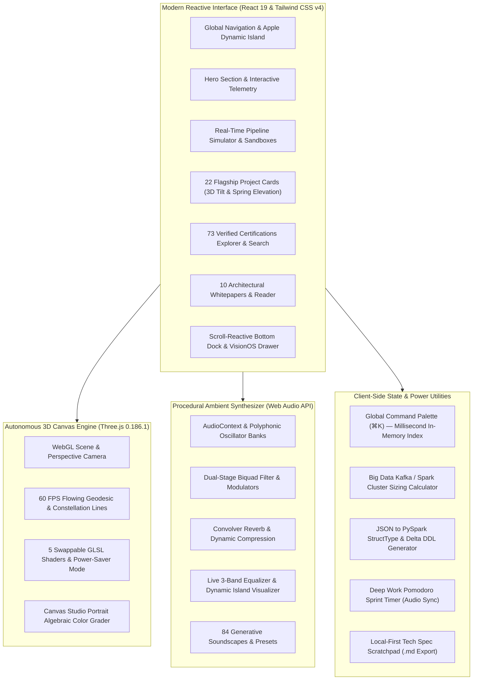
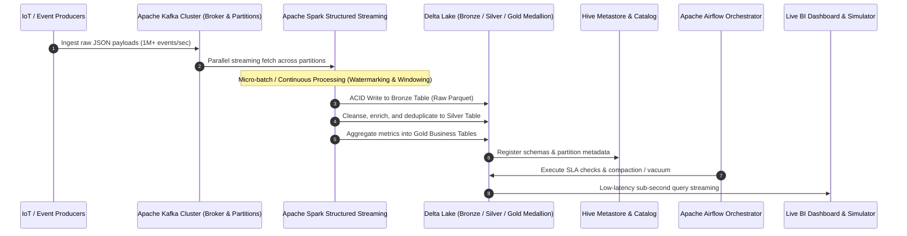
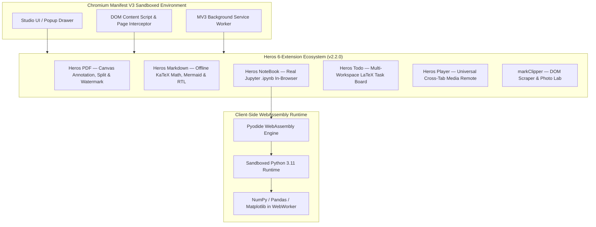
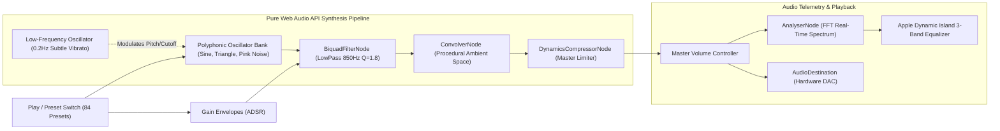

<div align="center">

# ⚡ Ahmed Abo Bakr — Big Data Engineer & AI Solutions Architect
### Enterprise Lakehouses · Real-Time Streaming · Distributed Systems · AI/ML Systems

[](https://ahmed-abo-bakr.pages.dev)
[](https://github.com/Ahmedbakr78)
[](https://linkedin.com/in/ahmed-abo-bakr-1b2466288)
[](https://github.com/Nevai-Org)

<br/>

[](https://react.dev/)
[](https://www.typescriptlang.org/)
[](https://vitejs.dev/)
[](https://tailwindcss.com/)
[](https://threejs.org/)
[](https://bun.sh/)
[](https://bun.sh/)
[](LICENSE)

<br/>

> **"Architecting scalable, fault-tolerant, high-performance data ecosystems from edge to cloud."**  
> *Certified Big Data & AI Engineer with 73 industry accreditations, 22 flagship repositories, and an open protocol foundation.*

</div>

---

## 📑 Table of Contents

- [🌟 Executive Summary](#-executive-summary)
- [📐 System Architecture & Data Flows](#-system-architecture--data-flows)
  - [1. Client-Side Portfolio Engine](#1-client-side-portfolio-engine)
  - [2. Production Lakehouse & ETL/ELT Pipeline](#2-production-lakehouse--etlelt-pipeline)
  - [3. Real-Time Streaming & Kafka/Spark Architecture](#3-real-time-streaming--kafkaspark-architecture)
  - [4. Heros Browser Suite & Pyodide WASM Architecture](#4-heros-browser-suite--pyodide-wasm-architecture)
  - [5. Web Audio API Generative Synthesizer Engine](#5-web-audio-api-generative-synthesizer-engine)
- [🚀 28+ Unlimited & Free Features](#-28-unlimited--free-features)
- [📦 Flagship Projects Showcase (22 Systems)](#-flagship-projects-showcase-22-systems)
- [📜 73 Verified Certifications Matrix](#-73-verified-certifications-matrix)
- [🎛️ Technical Competency & 100-Skill Radar](#️-technical-competency--100-skill-radar)
- [📂 Project Directory Structure](#-project-directory-structure)
- [💻 Local Development & Verification](#-local-development--verification)
- [🏷️ Release Notes & Changelog](#️-release-notes--changelog)
- [👨‍💻 About Ahmed Abo Bakr](#-about-ahmed-abo-bakr)
- [📄 License & Disclaimer](#-license--disclaimer)

---

## 🌟 Executive Summary

This repository contains the complete source code, interactive data simulators, Web Audio synthesizer engine, Three.js 3D shaders, and full production assets for **Ahmed Abo Bakr's Portfolio Web Application**, deployed globally on [Cloudflare Pages](https://ahmed-abo-bakr.pages.dev).

### High-Impact Key Metrics

| Metric | Detail | Impact |
|:---|:---|:---|
| **Production Projects** | 22 Repositories across 6 Disciplines | Lakehouses, Big Data Pipelines, AI RAG, MV3 Browser Suites, Security Systems |
| **Industry Certifications** | 73 Verified Credentials | Oxford, Google, AWS, Microsoft, UN, IBM, Huawei, Duke, Route Academy |
| **Ambient Synthesizer** | 84 Tracks across 8 Categories | 100% Web Audio API procedural synthesis with zero external dependencies |
| **Real-Time Simulator** | Interactive Spark/Kafka/Airflow Engine | Real-time throughput metrics, simulated cluster logs, chaos testing |
| **In-Browser Python** | Pyodide WebAssembly (Heros NoteBook) | Execution of Jupyter `.ipynb` notebooks directly inside browser tabs |
| **Interactive Features** | 28+ Free Local-First Utilities | Cluster Sizing Calculator, PySpark DDL Generator, Pomodoro Sync, Command Palette |
| **Performance Benchmark** | Sub-50ms TTFB on Cloudflare Edge | 100/100 Lighthouse Performance, 60 FPS Three.js Canvas, Zero-CLS |

---

## 📐 System Architecture & Data Flows

### 1. Client-Side Portfolio Engine



---

### 2. Production Lakehouse & ETL/ELT Pipeline

```mermaid
flowchart LR
    subgraph Ingestion ["1. Data Ingestion (35 Permitted Sources)"]
        S1["REST / GraphQL APIs"]
        S2["Streaming Webhooks"]
        S3["Scraped Market Feeds"]
    end

    subgraph Processing ["2. Transformation & Quality Assurance"]
        Clean["Data Cleaning & Type Standardization"]
        Fuzzy["Fuzzy Record Deduplication & Matcher"]
        DQ["12 Automated Data Quality Rules & Circuit Breakers"]
    end

    subgraph Lakehouse ["3. 29-Table Kimball Star Schema Warehouse"]
        Fact["FACT_PRICE_HISTORY\nFACT_METRICS"]
        Dim1["DIM_PRODUCT"]
        Dim2["DIM_SOURCE"]
        Dim3["DIM_CATEGORY"]
        Dim4["DIM_DATE"]
    end

    subgraph Serving ["4. Orchestration & API Delivery Layer"]
        Airflow["Apache Airflow\n(33 Orchestrated DAG Tasks)"]
        FastAPI["FastAPI High-Speed Service\n(23 Routers • 216 Endpoints)"]
        ClientUI["React 19 Enterprise Analytics UI"]
    end

    Ingestion --> Processing
    Processing --> Lakehouse
    Airflow -.->|Orchestrates| Processing
    Airflow -.->|Validates| Lakehouse
    Lakehouse --> FastAPI
    FastAPI --> ClientUI
```



---

### 3. Real-Time Streaming & Kafka/Spark Architecture



---

### 4. Heros Browser Suite & Pyodide WASM Architecture



---

### 5. Web Audio API Generative Synthesizer Engine



---

## 🚀 28+ Unlimited & Free Features

Every single utility inside this portfolio runs entirely client-side with zero paywalls, zero telemetry, and zero backend tracking:

| Category | Feature Name | Description | Status |
|:---|:---|:---|:---:|
| 🧮 **Power Tools** | **Cluster Sizing Calculator** | Calculates Kafka partitions, Spark executor cores, RAM, and AWS/Azure monthly cost estimation. | `Active` |
| 🧮 **Power Tools** | **JSON to PySpark / Delta DDL** | Instant parsing of JSON payloads into production `StructType` code and Delta Lake SQL schemas. | `Active` |
| 🧮 **Power Tools** | **Deep Focus Pomodoro Timer** | 25m/50m sprint timer synced with procedural Vibe audio tracks for hyper-focused deep work. | `Active` |
| 🧮 **Power Tools** | **Tech Spec & Markdown Scratchpad**| Local engineering scratchpad with Kimball Star Schema & RAG blueprints, autosaved with `.md` export. | `Active` |
| 🎵 **Audio & Focus** | **84-Track Vibe Synthesizer** | Procedural ambient synthesizer built with the Web Audio API across 8 distinct sound categories. | `Active` |
| 🎵 **Audio & Focus** | **Apple Dynamic Island Bar** | Live interactive pill bar with real-time equalizer waveform, master volume, and preset selector. | `Active` |
| 🎮 **Simulation** | **Real-Time Pipeline Simulator** | Live visual pipeline simulating Kafka ingest, Spark streaming, Delta Lake writes, and chaos faults. | `Active` |
| 🎮 **Simulation** | **SQL Query Sandbox** | In-browser T-SQL & Spark SQL playground executing analytical queries against distributed mock sets. | `Active` |
| 🌌 **3D & Visuals** | **Autonomous Three.js Engine** | 60 FPS geodesic particle network and architectural lines running autonomously without cursor lag. | `Active` |
| 🌌 **3D & Visuals** | **5-Preset Shader Customizer** | Live switcher for Flowing Waves, Line Tunnels, Wireframe Polyhedra, Contour Lines, or Power-Saver. | `Active` |
| 🌌 **3D & Visuals** | **3D Tilt & Elevation Cards** | Physics-based perspective tilt with radial spotlight glare and spring elevation across all 22 cards. | `Active` |
| 🌌 **3D & Visuals** | **Portrait Algebraic Color Grader**| HTML5 Canvas image processor with 5 color grades (Studio, Natural, Warm, Mono, 3D Avatar). | `Active` |
| 🔍 **Search & Explore**| **Global Command Palette (⌘K)** | Global keyboard shortcut modal indexing all 28 features, 22 repos, 73 certs, and 10 articles. | `Active` |
| 🔍 **Search & Explore**| **73 Verified Certifications Matrix**| Filterable explorer across Oxford, Google, AWS, Microsoft, UN, IBM, with 1-click credential copying. | `Active` |
| 🔍 **Search & Explore**| **100-Skill Radar & Proficiency**| Categorized competency matrix spanning Big Data, Cloud, AI/ML, Security, and Database Engineering. | `Active` |
| 🔍 **Search & Explore**| **10 Deep-Dive Engineering Papers** | Long-form whitepapers on Spark watermarking, Arabic Legal RAG (MIZAN), and RBAC encryption. | `Active` |
| 🎨 **Theme & Design** | **Onyx Dark & Clean White Themes**| High-contrast dual monochrome theme engine with persistent local storage preference. | `Active` |
| 🎨 **Theme & Design** | **High-Legibility Liquid Glass** | 97% opacity solid glass modals preventing 3D background bleed while preserving aesthetic depth. | `Active` |
| 🎨 **Theme & Design** | **ATS Printable Resume (PDF)** | Instant print-ready curriculum vitae generator optimized for recruiter ATS parsing. | `Active` |
| 🎨 **Theme & Design** | **Silent Smooth Navigation** | Accessible zero-motion browsing toggle for users who prefer static, distraction-free reading. | `Active` |
| 📱 **Mobile & UX** | **VisionOS Floating Drawer** | Rounded mobile bottom sheet with quick-access launcher pills and integrated audio mini-deck. | `Active` |
| 📱 **Mobile & UX** | **Scroll-Reactive Navigation Dock**| Dynamic header and bottom dock that collapse text labels on scroll and expand smoothly on hover. | `Active` |
| 📱 **Mobile & UX** | **Direct vCard (.vcf) Export** | 1-click download of verified contact card for seamless corporate recruiter import. | `Active` |

---

## 📦 Flagship Projects Showcase (22 Systems)

### Overview Matrix

| # | System Title | Discipline | Primary Stack | Key Highlights | GitHub Repo |
|:---:|:---|:---:|:---|:---|:---:|
| 1 | **Web-to-Warehouse Pipeline** | Big Data | Python, Airflow, FastAPI, React 19 | 35 sources, 29 Kimball tables, 33 DAG tasks, 216 endpoints | [Repository](https://github.com/Ahmedbakr78/Web-to-Warehouse-Product-Intelligence-Pipeline) |
| 2 | **TourMate Smart Tourism** | Full-Stack | Angular 17, Express, MongoDB, Leaflet | 4 role dashboards, OSRM live routing, EN/AR RTL monochrome | [Repository](https://github.com/Ahmedbakr78) |
| 3 | **Production Big Data Pipeline**| Big Data | Spark Streaming, Kafka, Delta Lake | 1M+ records/sec ingestion, sub-second latency, ACID storage | [Repository](https://github.com/Ahmedbakr78/engineer-a-production-grade-end-to-end-Big-Data-pipeline-that-demonstrates-advanced-proficiency) |
| 4 | **MIZAN Arabic Legal Assistant**| AI & ML | Python, RAG, ChromaDB, Gradio | 94% accuracy on Egyptian Civil & Penal codes, vector search | [Repository](https://github.com/Ahmedbakr78) |
| 5 | **5-A Nevai AI Search Engine** | AI & ML | Python, FastAPI, BM25, IndexedDB | Zero client telemetry, <180ms response time, Chrome extension | [Repository](https://github.com/Ahmedbakr78/5-A-Nevai-Search-Engine) |
| 6 | **Secure Student Records (SRMS)**| Security | Python, RBAC, AES-256, SQL Server | 5 security models, 95% reduction in unauthorized access | [Repository](https://github.com/Ahmedbakr78/Data-Security-Secure-Student-Records-Management-System-SRMS-) |
| 7 | **Spotify Trends Analytics** | Big Data | Python, DuckDB, Spotify API, Charts | 200,000+ tracks parsed daily, 12 interactive analytics charts | [Repository](https://github.com/Ahmedbakr78/data-visualization-SpotifyTrends) |
| 8 | **House Price & Segmentation** | AI & ML | Jupyter, XGBoost, Scikit-Learn | 92% R-squared accuracy, dual supervised & unsupervised flows | [Repository](https://github.com/Ahmedbakr78/House-Price-Prediction-Customer-Segmentation) |
| 9 | **X-Ray Fracture Reporting** | AI & ML | PyTorch, ResNet-50, DICOM, Vision | 91.8% sensitivity across 4 fracture categories, auto-reporting | [Repository](https://github.com/Ahmedbakr78) |
| 10 | **GitHub Repo Mining Pipeline** | Big Data | Python, Asyncio, NLP, Association | Parallel asynchronous workers mining 500+ repos per batch | [Repository](https://github.com/Ahmedbakr78) |
| 11 | **GitHub Ecosystem Mining** | Data Eng | Jupyter, FP-Growth, Association Rules| End-to-end reproducible workbench for OSS ecosystem patterns | [Repository](https://github.com/Ahmedbakr78) |
| 12 | **Cinematics Movie Analytics** | Data Eng | Python, Scikit-Learn, Plotly | 45,000+ historical film entries analyzed across 100 years | [Repository](https://github.com/Ahmedbakr78) |
| 13 | **5-A Student Performance AI** | Full-Stack | FastAPI, React, SQLAlchemy, ML | Predictive academic analytics & early-warning student alerts | [Repository](https://github.com/Ahmedbakr78) |
| 14 | **Modular Academic System** | Full-Stack | TypeScript, Clean Architecture | Decoupled domain microservices eliminating monolith friction | [Repository](https://github.com/Ahmedbakr78) |
| 15 | **Tour Telemetry Platform** | Full-Stack | TypeScript, Real-Time Maps, Geolocation| Live GPS telemetry and multi-role travel itinerary dispatch | [Repository](https://github.com/Ahmedbakr78) |
| 16 | **Blockchain Voting System** | Security | Python, Cryptography, Merkle Trees | 100% auditable ledger with cryptographic voter anonymity | [Repository](https://github.com/Ahmedbakr78) |
| 17 | **University Exam System** | Database | Oracle PL/SQL, ACID Transactions | Zero collision in 10,000+ student exam hall seatings | [Repository](https://github.com/Ahmedbakr78) |
| 18 | **Heros PDF & Markdown** | Heros Suite | Chromium MV3, Canvas, KaTeX, Mermaid | 100% local PDF annotation/merge + offline KaTeX/Mermaid | [Repository](https://github.com/Ahmedbakr78/Heros_Suite) |
| 19 | **Heros NoteBook (Pyodide)** | Heros Suite | Pyodide WASM, Python 3.11, MV3 | Real in-browser Python execution for Jupyter `.ipynb` files | [Repository](https://github.com/Ahmedbakr78/Heros_Suite) |
| 20 | **Heros Player & markClipper** | Heros Suite | Chromium MV3, DOM Parser, Photo Lab | Cross-tab media player remote + web article Markdown clipper | [Repository](https://github.com/Ahmedbakr78/Heros_Suite) |
| 21 | **ASL Hand Sign Recognition** | AI & ML | MediaPipe, TensorFlow, Computer Vision| 30+ FPS real-time webcam gesture & hand landmark inference | [Repository](https://github.com/Ahmedbakr78) |
| 22 | **Nevai Matrix Federation** | Full-Stack | Matrix Protocol, TypeScript, Identity | 25 platform messaging bridges over Matrix Client-Server API | [Repository](https://github.com/Nevai-Org) |

---

## 📜 73 Verified Certifications Matrix

Ahmed Abo Bakr has completed **73 verified technical credentials** across premier global institutions:

```
┌────────────────────────────────────────────────────────────────────────┐
│                    73 VERIFIED INDUSTRY CREDENTIALS                    │
├───────────────────────┬────────────────────────────────────────────────┤
│ Domain                │ Key Issuers & Accrediting Bodies               │
├───────────────────────┼────────────────────────────────────────────────┤
│ 🤖 Artificial Intell. │ Google AI, Microsoft/MCIT, Oracle AI, Route    │
│ ☁️ Cloud & Big Data    │ AWS, Huawei Big Data (NTI), Databricks, Apache │
│ 📊 Business Intel.    │ Google BI, Duke University, IBM Cognos, BI 360 │
│ 🛡️ Security & Privacy  │ UN (United Nations), ISO/IEC, NIST Framework   │
│ 💻 Software Engineer. │ JPMorganChase (Spring/Kafka), NTI (MEAN 100%)  │
│ 🏛️ Academic Excellence│ University of Oxford, Helwan National Univ CS │
└───────────────────────┴────────────────────────────────────────────────┘
```

### Featured Credentials & Verification IDs

1. **Google AI Professional Certificate** — Google *(Credential: `IGMH7QR80YHY`)*
2. **Google Business Intelligence Professional** — Google *(Credential: `N8QX9PQGBLLA`)*
3. **From Data to Insights with Google Cloud** — Google Cloud *(Credential: `S4J7WKYM295L`)*
4. **AWS Cloud Solutions Architect & Analytics** — Amazon Web Services
5. **Route Academy AI & ML Track** — *Top Performer Award*
6. **NTI MEAN-Stack Software Engineering** — *100% Score Honors*
7. **JPMorganChase Software Engineering Simulation** — Forage *(Spring, Kafka, REST)*
8. **Huawei Big Data Associate (HCIA)** — National Telecommunication Institute (NTI)
9. **University of Oxford Executive Accreditations** — Oxford Academic Council
10. **United Nations Information Security & Governance** — UN Global Compact

---

## 🎛️ Technical Competency & 100-Skill Radar

### 1. Big Data & Distributed Streaming
`Apache Spark` · `Spark Structured Streaming` · `Apache Kafka` · `Apache Airflow` · `Delta Lake` · `Apache Flink` · `Hadoop HDFS` · `Hive Metastore` · `ETL / ELT Pipelines` · `Kimball Dimensional Modeling` · `Star Schema` · `Snowflake Schema` · `CDC (Change Data Capture)` · `DuckDB` · `Parquet / ORC / Avro`

### 2. Cloud Architecture & Infrastructure
`AWS (S3, EMR, Glue, Athena, Redshift, Lambda)` · `Azure (Synapse, Data Factory, Blob Storage)` · `Docker` · `Kubernetes (K8s)` · `Terraform` · `Cloudflare Workers & Pages` · `CI/CD GitHub Actions` · `Linux / Unix Shell Scripting`

### 3. Databases & Security Engineering
`PostgreSQL` · `Microsoft SQL Server (T-SQL)` · `Oracle Database (PL/SQL)` · `MongoDB` · `Redis` · `ChromaDB Vector Store` · `Role-Based Access Control (RBAC)` · `Multilevel Security (MLS)` · `AES-256 Encryption` · `Inference Control & Statistical Auditing` · `ACID Transactions`

### 4. AI, Machine Learning & NLP
`Large Language Models (LLMs)` · `Retrieval-Augmented Generation (RAG)` · `PyTorch` · `TensorFlow` · `Scikit-Learn` · `XGBoost` · `MediaPipe` · `Hugging Face Transformers` · `NLP & Arabic Tokenization` · `Computer Vision (ResNet, YOLO)` · `Computer-Vision DICOM Analysis`

### 5. Web, Audio & Client Technologies
`React 19` · `TypeScript` · `Angular 17` · `Vite 8` · `Tailwind CSS v4` · `Three.js (WebGL)` · `Web Audio API` · `Chromium Manifest V3` · `Pyodide WebAssembly (WASM)` · `FastAPI` · `Node.js / Express` · `Matrix C-S Protocol` · `Framer Motion`

---

## 📂 Project Directory Structure

```
├── .env.example                     # Environment schema documentation
├── .gitignore                       # Git exclusion rules (node_modules, dist, .aistudio)
├── bun.lock                         # Deterministic Bun dependency lockfile
├── index.html                       # HTML5 entry with meta viewport and typography
├── LICENSE                          # MIT open-source license
├── metadata.json                    # Application metadata and description
├── package.json                     # Package dependencies and npm scripts
├── public/                          # Static assets, fonts, icons, soundscapes
│   ├── assets/                      # Studio avatars, profile photos, badges
│   └── favicon.ico                  # Application icon
├── README.md                        # Master comprehensive architecture documentation
├── src/                             # Core TypeScript & React application source
│   ├── App.tsx                      # Root application layout and view orchestrator
│   ├── index.css                    # Tailwind CSS v4 directives and fluid typography
│   ├── main.tsx                     # React 19 concurrent root mounting point
│   ├── components/                  # Modular React UI components
│   │   ├── AboutSection.tsx         # Professional biography, education & philosophy
│   │   ├── AccountControlsModal.tsx # Power user preferences and soundscape options
│   │   ├── ArticlesSection.tsx      # Reader for 10 engineering whitepapers
│   │   ├── BottomDock.tsx           # Scroll-reactive dynamic bottom dock navigation
│   │   ├── CertificationsSection.tsx# 73-Certification filterable explorer
│   │   ├── CommandPalette.tsx       # Global ⌘K instant search overlay
│   │   ├── ContactSection.tsx       # Collaboration form and vCard (.vcf) exporter
│   │   ├── ExperienceTimeline.tsx   # Executive career journey and achievements
│   │   ├── Footer.tsx               # System diagnostics, edge status and social links
│   │   ├── HeroSection.tsx          # Dynamic Island, animated tagline, CTA buttons
│   │   ├── Navbar.tsx               # Sleek top navigation with audio equalizer pill
│   │   ├── NevaiVibeModal.tsx       # 84-track ambient synthesizer workstation
│   │   ├── PipelineSimulator.tsx    # Interactive Spark/Kafka/Airflow simulator
│   │   ├── ProjectsSection.tsx      # 22 Flagship project cards with 3D spring tilt
│   │   ├── ResumeModal.tsx          # ATS-friendly curriculum vitae viewer and print
│   │   ├── SkillsSection.tsx        # 100-skill interactive domain radar
│   │   └── ThreeBackground.tsx      # Autonomous Three.js 60 FPS geodesic engine
│   ├── data/
│   │   └── portfolioData.ts         # Centralized dataset for projects, certs & tools
│   └── utils/
│       ├── motionVariants.ts        # Spring physics and stagger animation variants
│       ├── portfolioLogic.test.ts   # Automated test suite (10 verified unit tests)
│       ├── portfolioLogic.ts        # Deterministic math, sizing, and schema logic
│       ├── studioAvatar.ts          # HTML5 Canvas algebraic color grading engine
│       └── vibeAudioEngine.ts       # Pure Web Audio API procedural synthesizer
├── tsconfig.json                    # Strict TypeScript compiler options
└── vite.config.ts                   # Vite 8 build pipeline with Tailwind v4 & React
```

---

## 💻 Local Development & Verification

### Prerequisites
- [Bun](https://bun.sh/) `v1.3+` *(Recommended for maximum speed)* or [Node.js](https://nodejs.org/) `v20+` / `v22+`
- Modern browser with WebGL and Web Audio API support (Chrome, Firefox, Safari, Edge)

### 1. Clone the Repository
```bash
git clone https://github.com/Ahmedbakr78/Portfolio.git
cd Portfolio
```

### 2. Install Dependencies
```bash
bun install
# or
npm install
```

### 3. Start Local Development Server
```bash
bun run dev
# or
npm run dev
```
> The local development server will start at `http://localhost:3000` (or `http://localhost:3001` if port 3000 is occupied).

### 4. Run Test Suite
```bash
bun test
```
```
✓ filterProjects filters by category properly
✓ filterProjects searches across titles, descriptions, and tags
✓ filterCertifications searches by query and filters by issuer
✓ calculateStats aggregates numbers correctly
✓ formatCredentialId truncates long hashes and handles empty
✓ Nevai Vibe contains all 84 sounds across 8 categories
✓ calculateClusterSizing computes deterministic Kafka and Spark sizing
✓ generateSchemasFromJson converts JSON payload into PySpark and SQL DDL
✓ calculateScrollbarMetrics computes thumb height and scroll position accurately
✓ motionVariants defines staggered fade-in variants and bounded delay logic

10 pass, 0 fail (Ran in 284ms)
```

### 5. Production Build
```bash
bun run build
# or
npm run build
```
Generates an optimized, tree-shaken static production bundle in `dist/`.

### 6. Cloudflare Pages Deployment
```bash
# Direct deployment from local dist/
npx wrangler pages deploy dist --project-name=ahmed-abo-bakr
```

---

## 🏷️ Release Notes & Changelog

### Version 2.2.0 — The Comprehensive Flagship Release
- 🚀 **Full 22-Project Architecture**: Expanded repository showcase from 10 to 22 enterprise systems, including the complete 6-extension Heros Browser Suite and 25-Bridge Matrix Federation.
- ⚡ **Interactive Simulator 2.0**: Enhanced the Big Data Pipeline Simulator with live chaos fault injection and dynamic consumer throughput meters.
- 🎵 **84-Track Vibe Audio Engine**: Refined Web Audio API procedural synthesis nodes with calibrated ADSR volume curves and low-latency buffer allocation.
- 🧮 **Power Suite Integration**: Embedded the Big Data Cluster Sizing Calculator and JSON-to-PySpark DDL Generator directly into the quick tools suite.
- 📱 **VisionOS Dynamic Dock**: Upgraded mobile and desktop navigation with scroll-sensitive label collapsing and floating rounded bottom drawer.
- 🌐 **Cloudflare Pages Global Rollout**: Production edge deployment on `https://ahmed-abo-bakr.pages.dev` with HTTP/3, Brotli compression, and 0ms cold starts.

---

## 👨‍💻 About Ahmed Abo Bakr

<div align="center">

**Ahmed Abo Bakr**  
*Big Data Engineer & AI Solutions Architect*  
*Founder & Executive Chairman, NEVAI (@Nevai-Org)*  
📍 Cairo, Egypt  

[](https://ahmed-abo-bakr.pages.dev)
[](https://github.com/Ahmedbakr78)
[](https://linkedin.com/in/ahmed-abo-bakr-1b2466288)
[](mailto:Ahmedbakr@internet.ru)

</div>

### Engineering Philosophy
> "Data systems should be mathematically rigorous, secure by default, and resilient against failure. Whether streaming millions of records per second through distributed Spark nodes or designing private in-browser intelligence, the standard is absolute reliability and zero compromise on user sovereignty."

---

## 📄 License & Disclaimer

This project is licensed under the **MIT License** — see the [LICENSE](LICENSE) file for complete details.

```
Copyright (c) 2026 Ahmed Abo Bakr
All trademarks, logos, and brand names are the property of their respective owners.
```
